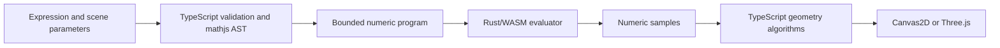

# The Rust/WASM computation boundary

Vinculum needs the same expression to behave consistently in the editor, in a
geometry worker, and after a scene is saved and reopened. The current design
keeps expression parsing and symbolic work in TypeScript, then sends a bounded
numeric program to Rust compiled to WebAssembly.

This is a description of the current implementation, not a claim that the whole
math engine has moved to Rust or that it is faster by a measured percentage.

## One expression, two responsibilities

[Expression-family compilers](../../apps/graph/lib/math/expressions/) validate
which variables, syntax and functions are allowed for a particular graph type.
mathjs still parses expressions, computes derivatives and performs symbolic
algebra. [The Rust bridge](../../apps/graph/lib/math/runtime/rustMath.ts)
walks the AST and emits pairs of numeric opcodes and operands into a postfix
program. Unknown nodes and unsupported functions are rejected.



The [Rust core](../../apps/graph/rust/math-core/src/lib.rs) receives numeric
buffers, not JavaScript callbacks or browser objects. Its private ABI exposes
allocation, scalar evaluation, grid sampling and deallocation. The application
bridge uses the same evaluator in the main thread, workers and tests; there is
no alternate JavaScript numeric evaluator used as a runtime fallback.

Saved scenes keep their canonical mathematical definitions. Compiled programs,
WASM pointers and sampled geometry are derived runtime data, so this migration
does not require a second saved-scene format.

## Batch sampling instead of a call per point

An implicit surface requires many samples of its left and right expressions.
[The implicit-surface compiler](../../apps/graph/lib/math/expressions/compileImplicitSurface.ts)
splits the requested grid into tiles and calls `evaluateGrid` for each side.
Each WASM batch accepts at most 2,048 samples, with at most 32 positions on each
axis. Rust iterates the batch; TypeScript assembles the resulting scalar field.

This reduces the number of JavaScript/WASM boundary crossings relative to
calling a scalar evaluator for every point. It does not move mesh construction,
marching tetrahedra, integration, or every sampling algorithm into Rust.

## Explicit limits and memory ownership

The bridge limits AST traversal to 2,500 nodes and a depth of 128. The Rust
interpreter separately bounds the program buffer and evaluation budget.
Expression-family safety checks still apply before compilation. These limits
bound the numerical work; they do not establish that every graph or numerical
answer is mathematically valid over its entire domain.

The bridge allocates program and scope buffers in WASM memory. It refreshes
`Float64Array` views before evaluation because memory growth can detach an older
buffer. Temporary grid allocations are freed in a `finally` block; the compiled
program allocations are registered for cleanup when they are no longer reachable.

## Compatibility is a testable contract

[The existing runtime tests](../../apps/graph/test/math/rustMath.test.ts) compare
supported real-valued expressions against mathjs across several inputs. They
also cover undefined symbols, rejected ASTs, domain holes, rounding behavior,
constants and overrides, grid ordering, sampling limits and memory growth while
earlier compiled programs are retained.

To run that focused suite after installing dependencies:

```sh
cd apps/graph
bun run test test/math/rustMath.test.ts
```

To validate the Rust source and rebuild the artifact from the repository root:

```sh
bun run test:rust
bun run build:wasm
```

The tests describe the supported numeric contract. They are not a benchmark or
a proof that arbitrary symbolic or numerical mathematics is correct. Future
ports can move one computation at a time while preserving that contract and the
existing scene format.
